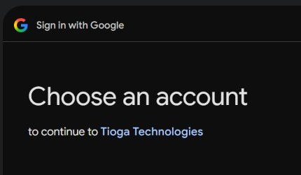

# Retail photo audit — 28 October 2026

Google sign-in branding is fixed and verified on the live customer account chooser. Google approved the existing **Tioga Technologies** app branding; it was published after switching the OAuth app from Testing to Production. The OAuth client ID and callback URL were retained. No additional scopes or credentials were introduced.

## Catalogue outcome

The audit covered all **1,097 static product records**, the **7 live database rows**, and the **1,083 listings** produced by the website's actual merge and deduplication rules.

| Live listing outcome | Count |
| --- | ---: |
| Replaced with a source-matched manufacturer/supplier original | 181 |
| Misleading, synthetic, unusable or unconfirmed imported photo withheld | 176 |
| Database listing has no assigned exact product photo | 3 |
| Existing photo retained; original source/model identity remains unconfirmed | 723 |

**This is not a certification that all 1,083 photos are authentic, clear and unique.** The full visual screen and technical audit are complete; the outstanding source verification and missing-photo work remain open. The retained group must not be presented as verified merely because a file exists or has a unique hash.

The user clarified that a clear genuine original is acceptable even below HD resolution. Of the 181 replacements, 110 have an original longest dimension of at least 1,000 pixels. The remaining accepted originals are smaller. Tiny supplier thumbnails were withheld rather than enlarged. Pixel dimensions alone do not establish sharpness or authenticity.

The eight active promotional-banner product images were also audited. Six now resolve to recovered manufacturer originals, including all five EcoFlow banners and SRNE. The configured AlpSolarr and Luxpower banner photos remain visually screened but without independently recovered source provenance. These are recorded separately in `retail-promo-images.csv`.

## Confirmed problems and corrections

- EcoFlow DELTA 2 Max and RIVER 3 Max Plus were illustrated with the wrong power stations. They now use the manufacturer's exact product/variant image. The PV220W generator listing has its actual station-and-panel bundle image. The E980 original was recovered from EcoFlow Nigeria's DELTA 2 Black listing. Nigerian regional originals are preferred for stations and the five promotional banners so the socket configuration is appropriate.
- Blue Carbon listings reused Exulted, De-Bull, Bread, Dawnice or other panel photos. Ten matching Blue Carbon originals were recovered from its own Nigerian catalogue; the remaining questionable imported photos are withheld.
- Several smart-switch entries showed watches, relays, a door lock, or a different number of switches. Other errors included a curtain track showing a welding inverter, a track connector showing furniture, and a camera power supply showing a solar camera.
- Several Bread panels and lights were drawn in SVG or recoloured from other models. These are not product photographs and are withheld.
- SolarPro battery/ESS listings pictured Solis inverter hardware. MECO and HiNEN listings pictured EcoFlow stations. Dawnice and Sorotech inverters pictured AlpSolarr hardware. Those cross-brand substitutions are withheld where no exact replacement was established.
- The Itel 620W panel import explicitly used a file described as a 550W panel. It is withheld pending an exact 620W photo.
- The Felicity FL-M580W image was blank. It is withheld pending an exact model photograph.
- The image resolver formerly guessed another brand/model from a category or product name. Missing or rejected photos now use an explicitly labelled pending state. Broken product images use the same neutral state.

Replacements are used in retail cards, quick view, comparison, product galleries, related-product recommendations, cart, wishlist and checkout. Prices and product availability were not changed.

## Duplicates and proof limits

The previous 1,097 files had distinct byte hashes. That was misleading: older generators deliberately added labels, recolouring and single-pixel changes to force uniqueness. Six unsafe generators have been disabled, and the tests no longer treat unique hashes as proof of authentic images.

Perceptual comparison found **198 near-duplicate candidate pairs** in the original catalogue, including changes that byte hashes missed. Candidates are not automatically errors: genuinely different capacities can share the same physical enclosure or an official family photograph.

The accepted sources themselves share a photograph across **10 groups** of listings. These are disclosed in `supplier-shared-photos.csv`. The originals were retained without fabricated badges or artificial visual differentiation. Unique, model-specific angles for those groups still require appropriate original photos; a claim of zero duplicates would be false.

## Outstanding work and source gaps

`source-verification-outstanding.csv` lists every active listing that still needs source verification or a replacement. `retail-live.csv` records every active listing, its current image, decision, source URL when recovered, original dimensions when known and the reason for its status. `catalogue-all-1097.csv` also preserves the static records hidden by name deduplication.

Many older Minisim entries are identified only by names such as Type 1/Type 3 or “Smart Device S/N…”, sometimes with conflicting WiFi/Zigbee descriptions. These cannot safely be matched to an arbitrary internet image without a manufacturer/model code or supplier confirmation. The current supplier catalogue contains 338 items; it does not establish all 584 older imported entries. The master sheet's image column predominantly contains “Image pending,” not original media URLs. The referenced April 2026 Minisim PDF was not present at the import script's expected local path.

Other entries need the exact stocked variant clarified. For example, “EcoFlow DELTA 2 / DELTA 3” combines two different models, “Dealer” is not a manufacturer/model identifier, and old-stock panel variants cannot be matched simply by wattage. The audit does not silently change model names, stock variants or specifications to fit an available photo.

## Evidence files and maintenance

- `image-decisions.json`: reviewed replacements/withdrawals, sources and reasons.
- `source-plan.json`: original media URLs for reproducible downloads.
- `summary.json`: counts for the live and static catalogues.
- `near-duplicate-candidates-before.csv`: perceptual comparison candidates.
- `supplier-shared-photos.csv`: accepted originals reused by the primary source.
- `google-account-chooser.png`: cropped live proof without customer account details.

The working acquisition data is kept in the ignored `supabase/.temp` folder. Source preparation/refinement scripts consume those saved public supplier/manufacturer catalogues; they do not update prices. The downloader records actual source dimensions and only resizes downwards. To recover the reviewed download plan on a clean checkout, copy `source-plan.json` to `supabase/.temp/retail-image-source-plan.json` before running `scripts/fetch-retail-image-originals.mjs`. Reapplying decisions requires the original catalogue snapshot and visual review notes; do not infer authenticity from automated name similarity.

Validation: all 122 automated tests, the production build, and TypeScript checks passed after the final source refinement. Browser checks confirmed a corrected EcoFlow product gallery, the pending state in catalogue and quick view, and the live Google account chooser name. Deployment verification is recorded in the task completion update.
